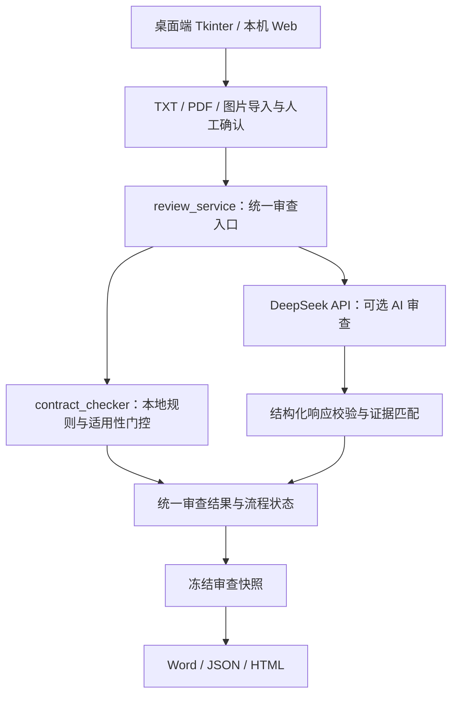

# 借保查 · JieBaoCha

**面向借款、保证与抵押合同的法律 AI 辅助审查 Agent**

A local-first legal AI prototype for loan and guarantee contract review, combining deterministic rules, optional LLM reasoning, evidence verification and regression evaluation.

> 当前状态：2026-11-26 求职展示冻结版（可运行 Demo，持续进行可靠性评测）。本项目用于合同初筛与律师人工复核，不替代正式法律意见。

## 项目目标

法律 AI 的价值不仅在于生成审查意见，更在于让意见可以核查、让错误可以复现、让改进可以衡量。借保查从借款担保这一单点业务出发，将律师审查任务拆解成明确的输入、规则、模型推理、证据核验和交付流程。

项目由本人独立主导需求定义、法律规则设计、测试标准与验收，结合 AI 编程工具开展工程实现与迭代。

## 核心能力

- **双端交互：** Tkinter 桌面端与本机 Web 端，共用审查服务。
- **文档输入：** 支持粘贴、TXT、图片和 PDF；PDF 优先提取文本，扫描页使用本地 CPU OCR，识别文本需人工校正确认。
- **混合审查：** 本地规则筛查与可选 DeepSeek API 审查；无需 API Key 即可体验本地规则。
- **结构化输出：** 校验风险等级、问题描述、理由及原文证据；区分精确匹配、空白差异匹配与未匹配证据。
- **失败处理：** AI 请求或响应校验失败时保留本地结果；输入变更后旧审查快照失效。
- **报告交付：** Word、JSON、HTML 共用同一次审查快照，导出不重复调用模型。

## 系统架构



确定性代码负责输入一致性、固定规则、证据匹配和报告留档；模型负责辅助分析。无法确认的法律判断应交由人工复核。

## 可靠性工程与阶段成果

采用人工预设标签、固定样本、错误归因、定向修复及回归测试的迭代方法，而非仅以模型回答是否流畅来判断质量。

| 专项场景 | 修复前 | 冻结版 |
| --- | --- | --- |
| 5 个指定正向保证表达样本 | 0/5 识别通过 | 5/5 识别通过 |
| GOLD-001：明确无第三人保证的纯抵押样本 | 5 条不适用保证提示 | 0 条 |
| 跨行借款人自担保证 | 错误识别为明确连带保证 | 转人工核验 |
| 同段条件字段割裂 | 错误识别为明确连带保证 | 转人工核验 |
| B01：承诺主体待核实 | 2 条重复提示 | 1 条带原句及主体的精准提示 |

上述数字来自指定样本的历史对照及冻结版交付记录，不代表总体法律准确率、整体误报率或真实客户使用效果。工程测试通过也不等于法律标签已全部完成人工验收。

详见 [冻结版发布说明](MERGE_RELEASE_NOTES.md)、[保证方式边界测试](test_guarantee_mode_boundaries.py)、[回归测试](test_guarantee_mode_regression.py) 及 [测试样本](test_samples/guarantee_mode/)。

## 快速开始

推荐环境：Windows x64 / Python 3.12。以下命令在 PowerShell 中执行。

```powershell
git clone https://github.com/ENjuto-87/JieBaoCha.git
cd JieBaoCha
py -3.12 -m venv .venv
.\.venv\Scripts\python.exe -m pip install -r requirements.txt
```

启动本机 Web 端：

```powershell
.\.venv\Scripts\python.exe web_server.py
```

浏览器访问 http://127.0.0.1:8765 。也可双击 `启动网页版.bat`。

启动桌面端：

```powershell
.\.venv\Scripts\python.exe demo_gui.py
```

也可双击 `启动合同审查Demo.bat`。需要 PDF、图片导入与 OCR 时，再安装可选依赖：

```powershell
.\.venv\Scripts\python.exe -m pip install -r requirements.txt -r requirements-ocr.txt -c requirements-tested.txt
```

AI 默认为可选项。启用时使用 `配置AI接口.bat` 设置本机加密配置，或通过进程环境变量 `DEEPSEEK_API_KEY` 配置。不要将密钥写入源码、提交记录或报告。模型 ID 与其他配置见 [AI 接口使用说明](AI接口使用说明.md)。

### 无 API Key 演示

在文本框粘贴以下虚构样本，确认原文，关闭 AI 模式并开始审查：

```text
甲向乙出借人民币100万元。乙以其享有的土地经营权提供抵押担保。
本合同没有第三人提供保证，双方也不存在其他保证合同。
```

预期：不套用保证方式、保证期间、保证范围等保证专属检查，保留其他适用的本地待核查提示；流程消息说明适用范围。再导出 JSON 或 HTML 检查报告原文与结果。

完整操作参见 [交付使用说明](交付使用说明.md)、[网页版使用说明](网页版使用说明.md) 与 [三分钟演示脚本](三分钟交付演示脚本.md)。较早文档中关于保证/抵押识别的描述属于历史状态，以本次冻结版发布说明为准。

## 测试与复现

```powershell
# 统一离线回归入口（含送达地址回归）
.\.venv\Scripts\python.exe run_checks.py

# 保证方式专项
.\.venv\Scripts\python.exe -m unittest -v test_guarantee_mode_regression test_guarantee_mode_boundaries

# 本机 Web 与启动器
.\.venv\Scripts\python.exe -m unittest -v test_web test_launchers
```

OCR 与 GUI 的进一步测试需安装对应依赖并准备测试样本及适用环境；可通过 `run_checks.py --ocr` 执行扩展检查。平台专属跳过、依赖缺失与实际失败应分别记录，不将跳过计入通过数。离线测试不能替代真实 API、真实 OCR 与 Windows 人工验收。

## 项目结构

| 文件 / 目录 | 职责 |
| --- | --- |
| `contract_checker.py` / `address_rules.py` | 法律规则、保证方式候选识别与送达地址检查 |
| `review_service.py` / `reliability.py` | 审查编排、流程状态和证据核验 |
| `ai_client.py` / `ai_config.py` | 模型请求与本机配置 |
| `source_import.py` / `ocr_engine.py` | 文档导入与本地 OCR |
| `demo_gui.py` / `web_server.py` / `web/` | 桌面端与本机浏览器端 |
| `report_export.py` / `report_docx.py` | 快照及多格式报告导出 |
| `test_*.py` / `test_samples/` | 自动化测试与样本 |
| `SOURCE_MANIFEST.json` | 原冻结版源码完整性清单（不含后续新增 README） |

## 已知局限与后续方向

- 保证关系适用性目前仍采用二态门控，事实不足与明确不存在需要进一步区分；非典型保证承诺、主体别名和跨段上下文仍有识别边界。
- 证据匹配只能证明引用文字存在，不能证明涵摄逻辑或法律结论正确。当前无独立法律规则数据库或在线法源核验。
- OCR 可能识别错误；报告可能包含完整合同原文。真实合同须人工脱敏并取得必要授权，启用 AI 后确认文本将发送给配置的模型服务商。
- 本机 Web 仅监听回环地址，不提供生产级多用户认证、数据库、权限控制或公网部署。
- 尚未建立足以估计整体法律准确率、漏报率与商业交付效果的大规模评测。

后续优先完善保证关系三态判断、主体归属及人工法律验收，再扩大场景覆盖。

## 第三方依赖与许可

第三方依赖及来源见 [开源来源与许可](开源来源与许可.md)。尤其是 PyMuPDF 的 AGPL / 商业双许可，公开分发或商业部署前须结合实际使用方式核对许可。本仓库未声明独立项目的开源许可证，不将源码可访问等同于已授予开源许可。

---

**设计原则：先建立标准，再定位错误，以回归数据证明改进；不将模型的不确定性包装成确定的法律结论。**
